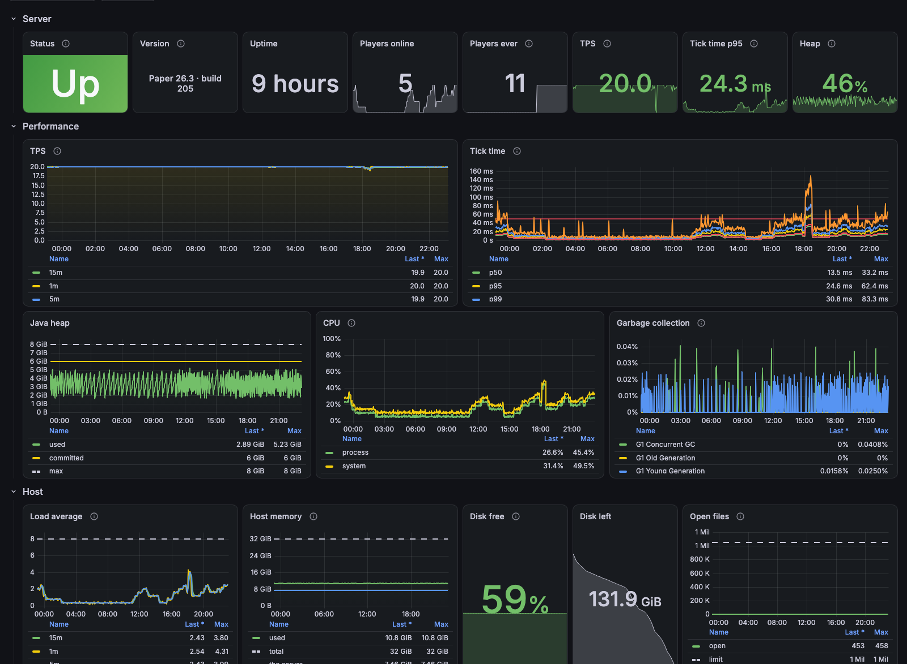
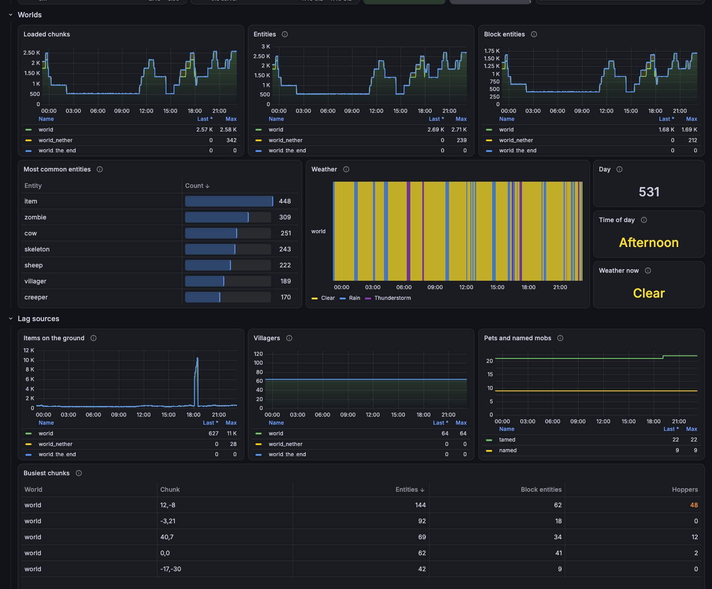
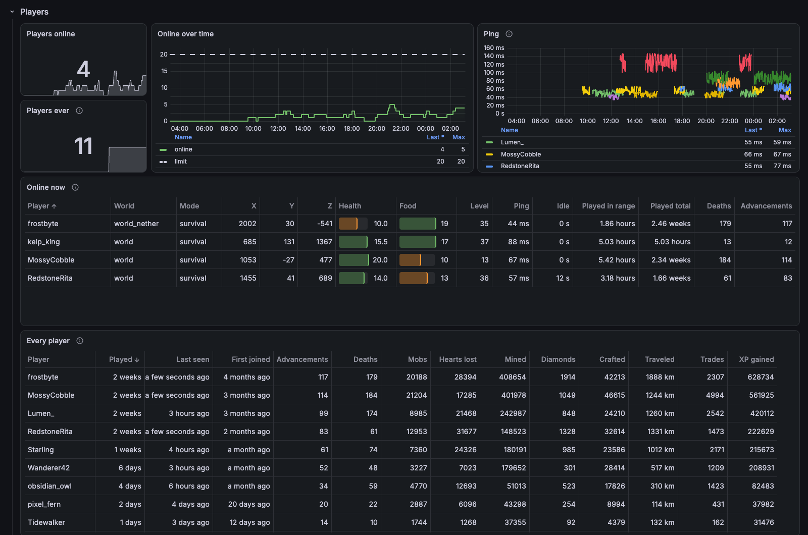
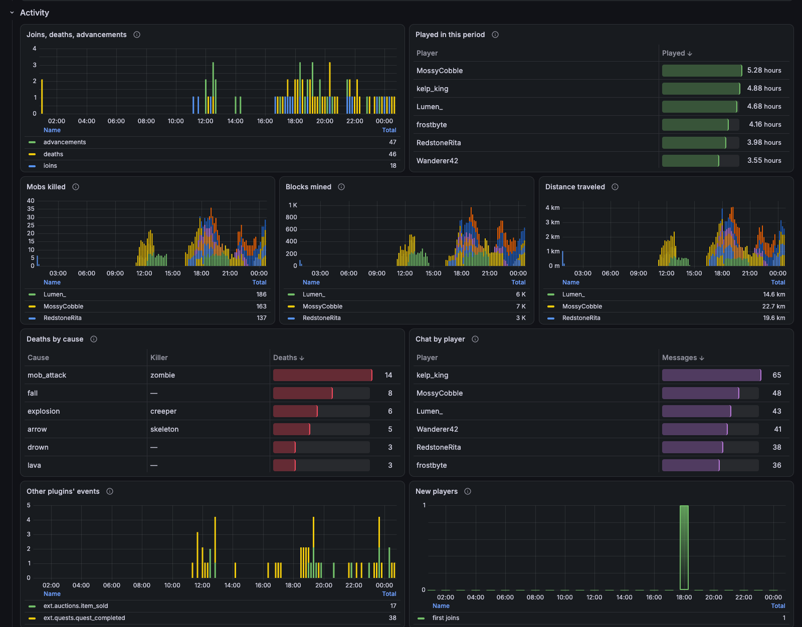
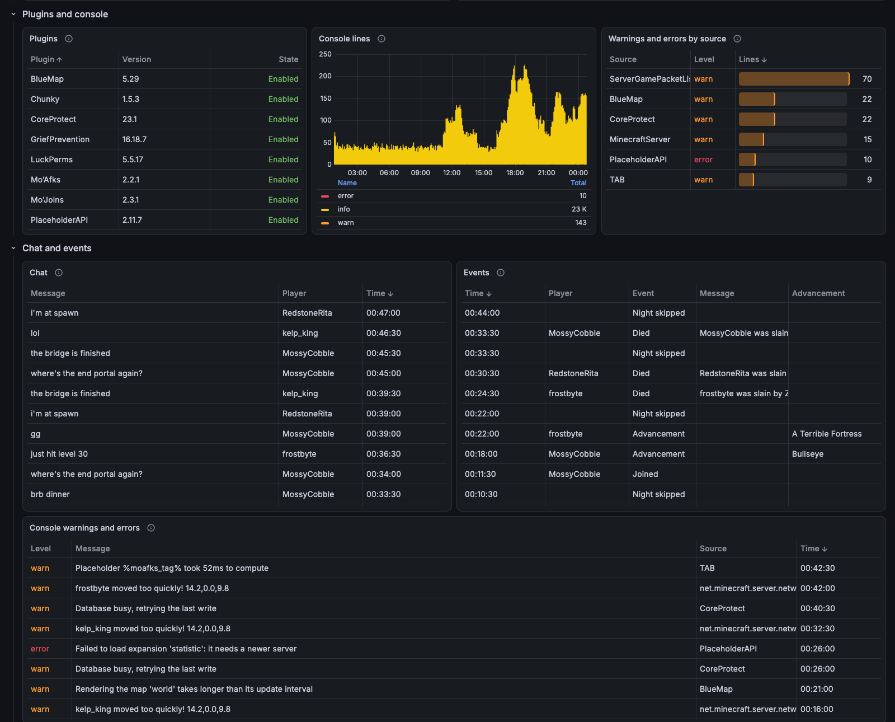

# Дашборд Minecraft для Grafana

  
  
  
  
  

📈 Дашборд Grafana для сервера Minecraft: как быстро он тикает, чем заполнены миры, кто играет и что делает, и чат. Он рисует метрики [minecraft-exporter](https://github.com/MairwunNx/minecraft-exporter), который читает сервер через [WorldAPI](https://github.com/MairwunNx/minecraft-worldapi).

[English version](README.md)

## Что внутри

- 🟢 **Сервер одним взглядом:** работает ли он, версия, аптайм, игроки онлайн и за всё время, TPS, время тика, куча.
- ⏱️ **Производительность:** TPS, время тика по перцентилям рядом с линией 50 мс, за которой сервер начинает лагать, куча, CPU, сборка мусора.
- 🌍 **Миры:** загруженные чанки, сущности, блочные сущности, самые частые сущности, погода на шкале времени, номер дня и время суток.
- 🧑‍🤝‍🧑 **Игроки:** кто онлайн, где стоит, его здоровье, сытость, уровень, пинг и время в игре; кто больше всех играл за выбранный период; пожизненная статистика каждого, от смертей до алмазов.
- 💀 **Активность:** входы, смерти и достижения во времени, смерти по причинам и убийцам, чат по игрокам, новые игроки и события других плагинов.
- 💬 **Чат, события и предупреждения консоли** таблицами, прямо из WorldAPI.
- ⚔️ **Mo’Bosses**, если он стоит на сервере: живые, появившиеся и убитые боссы по типам и классам и лучшие охотники, прямо из WorldAPI.
- 🔐 **Больше с токеном WorldAPI:** нагрузка и диск машины, что лагает в каждом мире вплоть до самых загруженных чанков, плагины с версиями и консоль.
- 🛰️ **Много серверов, один дашборд:** сервер и игроков выбирают вверху, а перезапуски отмечены на всех графиках.

### Как это выглядит

Миры и то, чем они забиты, вплоть до самых загруженных чанков:

Кто онлайн, где и в каком состоянии, и пожизненная статистика каждого игрока:

Что игроки делали за выбранный период:

Плагины, консоль, чат и события:

На скриншотах выдуманный сервер, чтобы каждой панели было что показать.

> [!WARNING]
> **Держите дашборд закрытым, если за ним стоит токен.** Любой зритель Grafana может отправить её источникам данных любой запрос и прочитать всё, что разрешает токен: чат, консоль, координаты каждого игрока. Что делать — на странице [Keeping it private](https://github.com/MairwunNx/minecraft-grafana/wiki/Keeping-it-private).

## Как начать

1. В Grafana 11 или новее откройте **Dashboards → New → Import** и введите `25941` или загрузите [`minecraft.json`](https://github.com/MairwunNx/minecraft-grafana/releases/latest/download/minecraft.json) из последнего релиза.
2. Выберите Prometheus, который опрашивает [minecraft-exporter](https://github.com/MairwunNx/minecraft-exporter), а для таблиц чата и событий — [источник Infinity](https://github.com/MairwunNx/minecraft-grafana/wiki/Data-sources), направленный на WorldAPI.
3. Готово: откройте дашборд и выберите сервер вверху.

## Документация

Всё по шагам — в [вики](https://github.com/MairwunNx/minecraft-grafana/wiki), на английском.

**Владельцам серверов:** [Installation](https://github.com/MairwunNx/minecraft-grafana/wiki/Installation) · [Data sources](https://github.com/MairwunNx/minecraft-grafana/wiki/Data-sources) · [Keeping it private](https://github.com/MairwunNx/minecraft-grafana/wiki/Keeping-it-private) · [What the dashboard shows](https://github.com/MairwunNx/minecraft-grafana/wiki/What-the-dashboard-shows) · [Variables](https://github.com/MairwunNx/minecraft-grafana/wiki/Variables) · [Troubleshooting](https://github.com/MairwunNx/minecraft-grafana/wiki/Troubleshooting)

**Разработчикам:** [Editing the dashboard](https://github.com/MairwunNx/minecraft-grafana/wiki/Editing-the-dashboard) · [Releasing](https://github.com/MairwunNx/minecraft-grafana/wiki/Releasing)

## Связанные проекты

- **[Moonlands](https://minecraft.mairwunnx.com)** — хардкорный сервер, где всё это работает.
- **[WorldAPI](https://github.com/MairwunNx/minecraft-worldapi)** — REST и WebSocket API к миру, игрокам и статистике сервера Paper.
- **[Minecraft MCP](https://github.com/MairwunNx/minecraft-mcp)** — даёт ИИ-клиенту читать сервер и управлять им через WorldAPI.
- **[Allay](https://github.com/allay-ai/minecraft)** — ИИ-помощник в игре: спросите через `/ask` прямо в чате.
- **[Allay Server](https://github.com/allay-ai/server)** — бэкенд Allay.
- **[Mo’Joins](https://github.com/MairwunNx/mojoins)** — сообщения о входе и выходе на языке каждого игрока.
- **[Mo’Afks](https://github.com/MairwunNx/moafks)** — безопасный AFK-режим, который не мешает пропустить ночь.
- **[Mo’Bosses](https://github.com/MairwunNx/mobosses)** — монстры, которые появляются боссами с классами, умениями и добычей.
- **[minecraft-exporter](https://github.com/MairwunNx/minecraft-exporter)** — метрики Prometheus из WorldAPI.

Moonlands, мой сервер для хардкорного выживания с друзьями, держит этот дашборд в закрытой Grafana. Его сайт показывает игроков и зал славы всем.

> 🫡 Сделал Павел Ерохин (Pavel Erokhin), он же mairwunnx.
